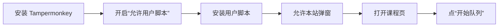
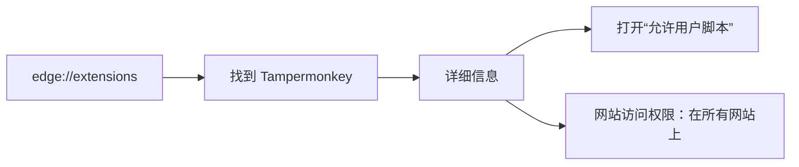
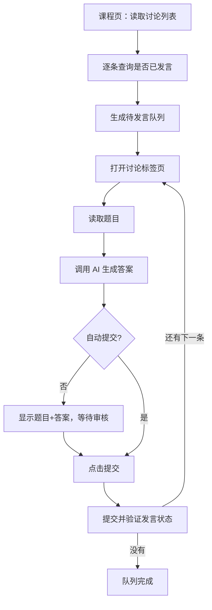
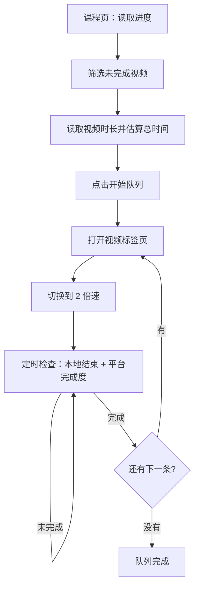

# 雨课堂刷课助手：视频 2 倍速队列 + 自动讨论 + AI 作业

一个 Tampermonkey / Violentmonkey 用户脚本：读取雨课堂（changjiang.yuketang.cn / 学堂在线）课程中**尚未完成**的视频，按课程顺序生成队列，在独立视频标签页中逐个以 **2 倍速**播放，自动检查完成情况并进入下一条。

> **搜索关键词**：雨课堂刷课、雨课堂脚本、学堂在线刷课、雨课堂视频队列、雨课堂自动讨论、雨课堂作业助手、雨课堂自动答题、AI 答题、Tampermonkey 用户脚本、Yuketang userscript、Yuketang helper、Yuketang automation、changjiang.yuketang.cn。

## English summary

A Tampermonkey / Violentmonkey userscript for Yuketang (changjiang.yuketang.cn, XuetangX): builds a queue of unfinished course videos and plays them serially in a dedicated tab at 2x speed; auto-completes discussions with your own AI API; and solves homework from rendered question screenshots using an AI vision model. It supports model-list fetching, OpenAI / OpenAI Responses / Anthropic / Gemini formats, double-answer consistency checks, and requires manual review before every homework submission.

同时支持**自动完成讨论**：读取未发言的讨论，在标签页中打开，调用你配置的 AI 接口生成可直接提交的答案；默认先在面板中展示题目和答案等你审核，确认后才提交，也可切换为全自动提交。

以及**作业助手**：读取未完成作业，在标签页中打开，把题目渲染成清晰截图交给支持视觉的 AI 作答，并**停在审核界面**；脚本不会自动提交作业，每次提交都必须由你核对后手动确认。

> **隐私说明**：本文和截图中的课程、视频、进度均为虚构示例数据，不包含真实账号、课程名称、老师或个人信息。脚本只在本地浏览器运行，不上传账号数据；AI 请求直接发往你自己填写的接口。
>
> **重要限制**：平台只支持 2 倍速。实测超过 2× 时，服务端会按实际时间和允许倍速校验进度，并把超前部分回滚。本项目不提供 3×/4×，也不提供伪造心跳、绕过防挂机或并行刷进度的功能。
>
> **讨论功能须知**：AI 生成的答案可能不准确。脚本默认自动提交，请在启用前确认模型与提示词质量；也可以关闭“自动提交”进入审核模式，逐条确认后再发送。提交即代表以你的账号在讨论区发言。
>
> **作业功能须知**：作业题目使用站点自定义字体加密。脚本默认把题目渲染成截图交给视觉模型，也可以切换为本地字形解码 + 文本模型；AI 答案仅供辅助，脚本**不会自动提交作业**，每次提交都需要你核对后手动确认。


## 目录

- [这个项目能做什么](#这个项目能做什么)
- [功能](#功能)
- [5 分钟快速开始](#5-分钟快速开始)
- [详细安装（Edge / Chrome）](#详细安装edge--chrome)
- [使用说明](#使用说明)
- [自动完成讨论（AI）](#自动完成讨论ai)
- [作业助手（AI 作答，人工审核）](#作业助手ai-作答人工审核)
- [预计剩余时间怎么算](#预计剩余时间怎么算)
- [运行流程](#运行流程)
- [常见问题](#常见问题)
- [项目结构](#项目结构)
- [进阶用法](#进阶用法)
- [免责声明](#免责声明)

## 这个项目能做什么

雨课堂的课程视频通常是串行的：同一时间只能学一个视频，而且播放页失去焦点会自动暂停。手动逐个点开、等它结束、再找下一个，很费时间。

这个脚本把流程整理成：

1. 读取课程进度，找出完成度低于 99.9% 的视频；
2. 生成待看队列，并估算整队剩余时间；
3. 打开一个新视频标签页；
4. 自动切到播放器自带的 **2 倍速**；
5. 计算需要等待的时间，到点检查本地播放位置和平台完成度；
6. 没看完就继续定时检查，看完就自动进入下一条。

它适合：**你愿意让视频标签页保持前台，但不想一直手动点“下一个”**。

## 功能

- **自动读取进度**：从课程接口读取视频列表、完成度和章节顺序。
- **待看队列**：只把未完成的视频加入队列，已完成的自动排除。
- **独立视频标签页**：课程页和播放页分开，避免在课程页里来回操作。
- **2 倍速**：复用播放器自己的倍速菜单，不是直接改 `video.playbackRate`（后者会被播放器重置）。
- **定时复查**：按“剩余时长 ÷ 实际倍速 + 2 秒”等待，到点检查平台进度；未完成则重新计算。
- **自动下一条**：平台进度达到要求后，复用视频标签页打开下一条。
- **整队时间预估**：读取每个视频的时长，结合当前完成度估算全部看完要多久。
- **断点续播**：中途看过的视频会从平台记录的上次位置继续。
- **状态面板**：课程页和视频页都有控制面板，支持开始、暂停、继续、停止。
- **自动完成讨论**：读取未发言的讨论队列，在新标签页打开；调用 AI 生成可直接提交的答案。
- **程序自动提交**：讨论功能默认由脚本自己完成提交和验证，不需要手动点击；可关闭“自动提交”切换为逐条审核。
- **作业助手**：读取未完成作业，把题目渲染成截图交给视觉模型（或本地解码交给文本模型），逐题作答并在面板中展示。
- **作业强制人工审核**：脚本不会自动提交作业，必须逐题核对后手动点击“提交作业”并再次确认。
- **多 AI 格式**：支持 OpenAI 兼容（DeepSeek/Kimi/GLM/通义/OpenAI 等）、Anthropic、Gemini。


*以上截图使用虚构示例数据。*

## 5 分钟快速开始



### 第 1 步：安装 Tampermonkey

在 Edge 或 Chrome 中安装 **Tampermonkey**：

- Edge：打开 Edge 加载项商店，搜索 Tampermonkey，点击“获取”。
- Chrome：打开 Chrome 应用商店，搜索 Tampermonkey，点击“添加至 Chrome”。

安装完成后，浏览器右上角会出现 Tampermonkey 图标。

### 第 2 步：开启“允许用户脚本”（新版 Chromium 必做）

新版 Edge/Chrome 默认禁止扩展注入用户脚本。只安装 Tampermonkey **还不够**。

1. 在地址栏输入并打开：`edge://extensions`（Chrome 是 `chrome://extensions`）；
2. 找到 **Tampermonkey / 篡改猴**，点击“详细信息”；
3. 打开 **“允许用户脚本 / Allow User Scripts”**；
4. 把 **“网站访问权限”** 设为“在所有网站上”，或至少包含 `changjiang.yuketang.cn`；
5. 如果页面顶部出现蓝色提示“请启用‘允许用户脚本’扩展设置”，直接点击它，按提示操作，然后刷新课程页。



> 找不到“允许用户脚本”时：先把 Tampermonkey 升级到最新版，并检查扩展页右上角是否开启了“开发者模式”。

### 第 3 步：安装用户脚本

打开本仓库中的 [yuketang-video-queue.user.js](./yuketang-video-queue.user.js)：

- 在 GitHub 页面点击 **Raw / 原始文件**；
- Tampermonkey 会弹出安装页面，点击“安装”；
- 或在 Tampermonkey 管理面板里新建脚本，把整个文件内容粘贴进去保存。

也可以先下载仓库，把 `.user.js` 文件直接拖进浏览器，Tampermonkey 会识别并提示安装。

### 第 4 步：允许本站弹窗

脚本需要一个独立的视频标签页：

- 点击地址栏左侧的网站设置 → **弹出式窗口和重定向** → 允许；
- 或者在面板提示“浏览器拦截了新标签页”时，点击“手动打开”。

### 第 5 步：打开课程页

登录雨课堂，进入你的课程：

- **学习日志**：`/v2/web/studentLog/...`
- 或 **学习内容**：`/pro/lms/.../studycontent...`

页面右下角会出现 **“雨课堂视频队列”** 面板。首次打开时，面板会读取进度和视频时长，预计时间会先显示“计算中…”，几秒后变成具体时长。

### 第 6 步：开始队列

1. 确认面板显示 **倍速 2.00×**；
2. 点击 **开始队列**；
3. 浏览器会打开一个视频标签页；
4. **让这个视频标签页保持前台并让浏览器窗口有焦点**；
5. 不要关闭视频标签页；课程页可以保留用来看进度。

完成后一条视频会自动切到下一条。全部结束后，面板显示“队列完成”。

## 详细安装（Edge / Chrome）

### Edge

1. 安装 Tampermonkey；
2. 打开 `edge://extensions`；
3. Tampermonkey → 详细信息；
4. 开启“允许用户脚本”；
5. 网站访问权限设为“在所有网站上”；
6. 安装本仓库的 `yuketang-video-queue.user.js`；
7. 刷新课程页。

### Chrome

步骤相同，只是扩展页是 `chrome://extensions`。Chrome 138+ 的用户脚本权限开关同样在扩展详情页。

### 安装后如何确认脚本真的在运行

打开课程页，按 `F12` → Console，刷新页面，应该看到类似：

```text
[雨课堂视频队列] v2.1.0 已加载：https://changjiang.yuketang.cn/...
```

如果看不到这行日志：

- 回到第 2 步检查“允许用户脚本”；
- 确认 Tampermonkey 的网站访问权限不是“点击时”；
- 确认脚本版本是 2.1.0 且处于启用状态；
- 刷新页面。

## 使用说明

### 课程页面板

| 元素 | 作用 |
| --- | --- |
| 待看 / 总计 / 已完成 | 当前课程视频统计 |
| 预计剩余 | 按 2×、当前进度和切换时间估算的整队剩余时间 |
| 倍速 2.00× | 平台支持的上限 |
| 开始队列 | 读取进度并启动 |
| 继续观看 | 从暂停或中断的位置继续 |
| 刷新 | 重新扫描进度（队列运行中不可用） |
| 停止 | 停止队列并暂停视频 |
| 待看队列 | 展开查看视频顺序和完成度 |

### 视频页面板

- 显示第几条、当前视频标题、平台完成度、本地播放时间和预计剩余；
- **暂停 / 继续**：暂停或恢复当前视频；
- **停止队列**：停止并回到课程页；
- **重新加载**：播放器加载失败时重试。

### 关于焦点和后台

雨课堂播放器会监听 `visibilitychange` 和窗口 `blur`。页面切到后台或浏览器窗口失去焦点时，它会主动暂停。这是站点的防挂机机制，脚本不会伪造焦点或鼠标活动。

- 切走：视频暂停，面板显示“等待回到视频页”；
- 回来并重新聚焦：脚本会自动恢复播放和计时；
- 如果播放器是被手动暂停的，点一下视频页或课程页的“继续”。

## 自动完成讨论（AI）

课程页左下角会出现 **“雨课堂讨论队列”** 面板（视频队列面板在右下角，两者互不影响）。

### 第 1 步：配置 AI 接口

展开面板里的 **“AI 设置”**，填写：

| 字段 | 说明 |
| --- | --- |
| 接口格式 | OpenAI 兼容 / Anthropic / Gemini |
| 请求地址 | 完整接口 URL，例如 `https://api.deepseek.com/chat/completions`、`https://api.anthropic.com/v1/messages` |
| API Key | 你的密钥，仅保存在本机 `localStorage`，请求直接发往你填写的地址 |
| 模型 | 例如 `deepseek-chat`、`claude-sonnet-4-5`；Gemini 的模型写在 URL 里，可留空 |
| 自动提交 | **默认关闭**。关闭时生成答案后停在讨论页等你审核；打开后生成即提交 |
| 提示词模板 | 默认按“直接给出可复制的最终答案、不含分析”的要求；`{题目}` 会替换成讨论题目 |

保存后会立即生效，队列运行中也可以修改，下一条生成时使用新配置。

> **跨域提示**：AI 请求从雨课堂页面发起，接口必须允许浏览器跨域（CORS）。OpenAI 兼容接口一般都可以；如果提示“可能是接口不允许浏览器跨域”，请更换接口或使用允许跨域的中转地址。

### 第 2 步：读取讨论队列

打开课程页（学习日志 / 学习内容）后，面板会自动读取课程结构和每条讨论的发言状态，显示 **待发言 / 讨论总数 / 已发言**。点“刷新”可重新扫描。

### 第 3 步：开始讨论队列

1. 点 **“开始讨论队列”**；
2. 浏览器打开一个讨论标签页并逐条处理；
3. 每条流程：读取题目 → 调用 AI 生成答案 → **停在“等待审核”**；
4. 在讨论页右下角面板中检查 **题目** 和 **AI 答案**，可以直接修改文本框内容；
5. 点 **“提交答案”** 才会真正提交；也可以用“重新生成”“跳过”“停止队列”；
6. 提交后脚本会轮询“是否已发言”，确认成功后自动进入下一条。

开启“自动提交”后，第 4、5 步会跳过，生成后直接提交并验证。



### 讨论功能常见问题

**AI 返回了答案但我觉得不对怎么办**

直接在答案文本框里修改后提交，或点“重新生成”。“跳过”会略过当前讨论并继续下一条。

**提交后提示未检测到发言状态**

通常是网络延迟或提交被平台拒绝。面板会保留答案，可以稍后重试；必要时到讨论页手动确认。

**提示内容可能包含敏感词**

平台拒绝了提交，请修改答案后再次提交。

**会不会重复提交**

脚本提交前会先检查该讨论是否已发言；已发言的会自动跳过。若提交中途关闭标签页，重新打开后会先复查状态，避免重复发言。

**API Key 安全吗**

Key 只保存在本机浏览器的 `localStorage` 中，只会发送给你填写的 AI 接口。请不要在公用电脑上保存。

## 作业助手（AI 作答，人工审核）

课程页左上角会出现 **“雨课堂作业队列”** 面板。它和讨论队列共用同一套 AI 设置。

### 工作方式

1. 从课程结构接口读取 `leaf_type=6` 的作业，按课程顺序排列；
2. 通过课程进度接口判断每个作业的完成情况（已答题数 / 总题数），只把未完成的加入队列；
3. 点“开始作业队列”后，在独立标签页逐条打开作业；
4. 读取作业题目数据，把题目和选项渲染成一张清晰的白底截图（加密字体按站点字体正确显示；截图固定 1000px 宽，脚本同时会把作业窗口调整到 1280×800 附近的固定比例）；
5. 默认把截图交给**支持图片输入（视觉）的模型**，提示词开头会带上“这是 课程名 章节名 的题目”，并要求“读题、直接给出符合题目要求的选项、只能回答 ABCD”，AI 按题号返回选项；
6. 面板同时展示这张截图和每题答案输入框（AI 答案已填好，可修改），状态停在“等待审核”；
7. **脚本不会自动提交作业**。你核对后点“提交作业”，再点一次“确认提交”，才会真正提交；
8. 提交后自动检查平台返回的对错：默认**答案错误就暂停**，显示你的选项和正确答案，需要你人工确认“继续下一条”；可在设置里关闭这个暂停功能；
9. 全部题目提交并验证完成后进入下一条。

### 答题方式

在作业面板的「AI 设置」里可以切换：

| 方式 | 说明 |
| --- | --- |
| 题目截图 + 视觉模型（默认） | 把题目渲染成 PNG 截图发给 AI。需要模型支持图片输入，例如 GPT-4o、Gemini、Claude、Qwen-VL、GLM-4V 等。不再依赖字体解码，题目所见即所得。 |
| 本地解码 + 文本模型 | 在浏览器本地用字形比对还原加密文字，再把文本发给普通文本模型。适合只有 DeepSeek 等纯文本模型的场景，个别生僻字可能识别不准。 |

### 支持范围

- 当前版本自动提交支持**单选题、多选题**；填空题、主观题、编程题会提示“需手动完成”，不会盲目提交。
- 截图模式需要视觉模型；如果接口不支持图片，会返回错误提示，改用“本地解码 + 文本模型”或更换模型即可。

### 作业功能常见问题

**为什么作业不能自动提交**

这是刻意设计的安全限制：作业会直接计入成绩，AI 答案必须经过你本人核对。任何一次作业提交都需要手动确认。

**截图模式提示模型不支持图片**

说明你填的模型是纯文本模型。请换成支持视觉的模型，或在「AI 设置」里切换为“本地解码 + 文本模型”。

**本地解码模式题目有错别字**

字形比对偶尔会把形状相近的字认错（例如生僻字）。题干仍可读，请结合选项判断；如影响作答，可切换截图模式或直接在答案框里修改。

**提交失败怎么办**

面板会显示具体错误并保留答案，可修正后重试；已成功提交的题目不会重复提交。

**答案错了会怎样**

默认开启“答案错误时暂停”：提交后如果平台反馈某题答案错误，脚本会立刻暂停并显示你选的答案和正确答案，等你人工确认后点“继续下一条”。如果不想暂停，可在作业面板的「AI 设置」里取消勾选该功能。

**AI 设置在哪里**

作业面板和讨论面板共用同一份 AI 配置，在任何一边保存都会生效。

## 预计剩余时间怎么算

```text
当前视频：实际剩余时长 / 当前倍速
后续视频：视频时长 × (1 - 平台完成度) / 2
每一条再额外加约 6 秒切换/加载时间
```

说明：

- 只按平台支持的 **2 倍速**估算；
- 会考虑每个视频已有的观看进度；
- 不包含暂停、缓冲、网络等待和失焦暂停时间；
- 从未打开过的视频，平台的时长接口有时返回 `0`，这部分会按已读取时长的平均值估算，并标注“含 N 条估算”；
- 如果连一条时长都读不到，会显示“暂时无法估算”。

## 运行流程



## 常见问题

### 页面没有出现面板

按顺序检查：

1. Edge/Chrome 的“允许用户脚本”是否打开；
2. Tampermonkey 的网站访问权限是否包含雨课堂域名；
3. 脚本版本是否为 2.1.0，是否启用；
4. 当前页面是否是“学习日志”或“学习内容”；
5. 刷新页面。

### 点击开始后没有打开视频标签页

浏览器拦截了弹窗。允许 `changjiang.yuketang.cn` 的弹窗，或点击面板里的“手动打开”链接。

### 视频为什么切到后台就暂停了

这是平台的防挂机检查，不是脚本故障。让视频标签页保持前台并聚焦即可；切回来会自动恢复。

### 能不能用 3× 或 4×

不能可靠使用。把播放器改到更高倍速后，平台会按实际时间和允许倍速校验进度，超出预期的部分会被服务端回滚，表现为“进度先涨后跳回”。本项目固定 2×。

### 能不能开多个浏览器并行

不建议，也通常不会更快。同一账号的并发会话会在服务端产生重叠的心跳记录，可能互相覆盖、只算一条或触发异常；同一台电脑上多个浏览器窗口也只有一个能拥有焦点，其他页面会被防挂机暂停。

### 预计时间为什么和实际有差异

预计时间是“按 2× 连续播放”的近似值，不包含缓冲、暂停、网络等待和失焦暂停。部分未打开过的视频时长只能按平均值估算。

### 脚本会不会上传我的账号或课程数据

不会。脚本在浏览器本地读取课程接口，不包含任何远程上报逻辑，也不会把账号、课程或进度发送到第三方。本文中的截图是虚构示例数据。

## 项目结构

```text
.
├── README.md
├── yuketang-video-queue.user.js    # Tampermonkey 用户脚本
├── scripts/
│   └── start-ykt-player.sh         # 进阶：Linux 独立 X 显示启动脚本
├── docs/
│   ├── images/
│   │   ├── course-panel.png        # 虚构示例界面
│   │   └── player-panel.png
│   └── advanced-xephyr.md          # 进阶：独立显示/虚拟机方案
└── LICENSE
```

## 进阶用法

如果你的系统支持 Xephyr，或者你愿意使用虚拟机/第二台设备，可以让视频页运行在独立显示里，同时用主桌面做别的事。详见：

- [进阶：独立显示运行](docs/advanced-xephyr.md)

即使使用独立显示，平台仍然可能限制并发和统计速度；不要把“自动化”当成绕过平台规则的手段。

## 免责声明

- 本项目用于个人学习、浏览器自动化和前端技术研究；
- 使用真实课程前，请确认课程和平台允许 2 倍速播放与自动切换；
- 讨论功能使用 AI 生成内容，质量取决于你配置的模型，请务必先审核再提交；因提交不准确内容造成的成绩或纪律问题由使用者自行承担；
- 作业助手会把题目渲染为截图或本地解码后交给 AI 生成答案，脚本不会自动提交作业；请务必逐题核对后再提交，因答案错误造成的成绩问题由使用者自行承担；
- 本项目不提供伪造进度、绕过防挂机、并发刷课或多账号操作；
- 因平台改版、接口变化或使用不当造成的进度异常、账号风险，由使用者自行承担。
