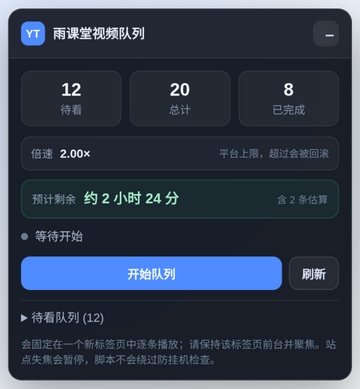
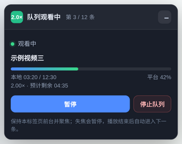
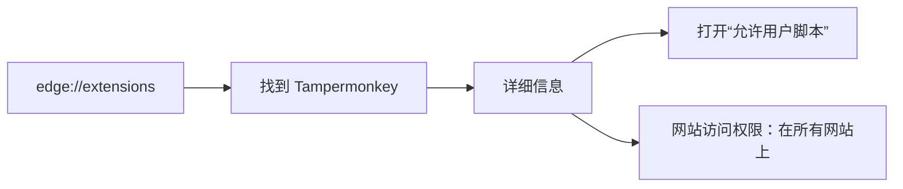
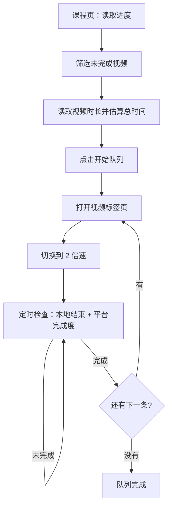

# 雨课堂视频串行队列

一个 Tampermonkey / Violentmonkey 用户脚本：读取雨课堂课程中**尚未完成**的视频，按课程顺序生成队列，在独立视频标签页中逐个以 **2 倍速**播放，自动检查完成情况并进入下一条。

> **隐私说明**：本文和截图中的课程、视频、进度均为虚构示例数据，不包含真实账号、课程名称、老师或个人信息。脚本只在本地浏览器运行，不上传账号数据。
>
> **重要限制**：平台只支持 2 倍速。实测超过 2× 时，服务端会按实际时间和允许倍速校验进度，并把超前部分回滚。本项目不提供 3×/4×，也不提供伪造心跳、绕过防挂机或并行刷进度的功能。



## 目录

- [这个项目能做什么](#这个项目能做什么)
- [功能](#功能)
- [5 分钟快速开始](#5-分钟快速开始)
- [详细安装（Edge / Chrome）](#详细安装edge--chrome)
- [使用说明](#使用说明)
- [预计剩余时间怎么算](#预计剩余时间怎么算)
- [运行流程](#运行流程)
- [常见问题](#常见问题)
- [项目结构](#项目结构)
- [进阶用法](#进阶用法)
- [免责声明](#免责声明)

## 这个项目能做什么

雨课堂的课程视频通常是串行的：同一时间只能学一个视频，而且播放页失去焦点会自动暂停。手动逐个点开、等它结束、再找下一个，很费时间。

这个脚本把流程整理成：

1. 读取课程进度，找出完成度低于 99.9% 的视频；
2. 生成待看队列，并估算整队剩余时间；
3. 打开一个新视频标签页；
4. 自动切到播放器自带的 **2 倍速**；
5. 计算需要等待的时间，到点检查本地播放位置和平台完成度；
6. 没看完就继续定时检查，看完就自动进入下一条。

它适合：**你愿意让视频标签页保持前台，但不想一直手动点“下一个”**。

## 功能

- **自动读取进度**：从课程接口读取视频列表、完成度和章节顺序。
- **待看队列**：只把未完成的视频加入队列，已完成的自动排除。
- **独立视频标签页**：课程页和播放页分开，避免在课程页里来回操作。
- **2 倍速**：复用播放器自己的倍速菜单，不是直接改 `video.playbackRate`（后者会被播放器重置）。
- **定时复查**：按“剩余时长 ÷ 实际倍速 + 2 秒”等待，到点检查平台进度；未完成则重新计算。
- **自动下一条**：平台进度达到要求后，复用视频标签页打开下一条。
- **整队时间预估**：读取每个视频的时长，结合当前完成度估算全部看完要多久。
- **断点续播**：中途看过的视频会从平台记录的上次位置继续。
- **状态面板**：课程页和视频页都有控制面板，支持开始、暂停、继续、停止。



*以上截图使用虚构示例数据。*

## 5 分钟快速开始


### 第 1 步：安装 Tampermonkey

在 Edge 或 Chrome 中安装 **Tampermonkey**：

- Edge：打开 Edge 加载项商店，搜索 Tampermonkey，点击“获取”。
- Chrome：打开 Chrome 应用商店，搜索 Tampermonkey，点击“添加至 Chrome”。

安装完成后，浏览器右上角会出现 Tampermonkey 图标。

### 第 2 步：开启“允许用户脚本”（新版 Chromium 必做）

新版 Edge/Chrome 默认禁止扩展注入用户脚本。只安装 Tampermonkey **还不够**。

1. 在地址栏输入并打开：`edge://extensions`（Chrome 是 `chrome://extensions`）；
2. 找到 **Tampermonkey / 篡改猴**，点击“详细信息”；
3. 打开 **“允许用户脚本 / Allow User Scripts”**；
4. 把 **“网站访问权限”** 设为“在所有网站上”，或至少包含 `changjiang.yuketang.cn`；
5. 如果页面顶部出现蓝色提示“请启用‘允许用户脚本’扩展设置”，直接点击它，按提示操作，然后刷新课程页。



> 找不到“允许用户脚本”时：先把 Tampermonkey 升级到最新版，并检查扩展页右上角是否开启了“开发者模式”。

### 第 3 步：安装用户脚本

打开本仓库中的 [yuketang-video-queue.user.js](./yuketang-video-queue.user.js)：

- 在 GitHub 页面点击 **Raw / 原始文件**；
- Tampermonkey 会弹出安装页面，点击“安装”；
- 或在 Tampermonkey 管理面板里新建脚本，把整个文件内容粘贴进去保存。

也可以先下载仓库，把 `.user.js` 文件直接拖进浏览器，Tampermonkey 会识别并提示安装。

### 第 4 步：允许本站弹窗

脚本需要一个独立的视频标签页：

- 点击地址栏左侧的网站设置 → **弹出式窗口和重定向** → 允许；
- 或者在面板提示“浏览器拦截了新标签页”时，点击“手动打开”。

### 第 5 步：打开课程页

登录雨课堂，进入你的课程：

- **学习日志**：`/v2/web/studentLog/...`
- 或 **学习内容**：`/pro/lms/.../studycontent...`

页面右下角会出现 **“雨课堂视频队列”** 面板。首次打开时，面板会读取进度和视频时长，预计时间会先显示“计算中…”，几秒后变成具体时长。

### 第 6 步：开始队列

1. 确认面板显示 **倍速 2.00×**；
2. 点击 **开始队列**；
3. 浏览器会打开一个视频标签页；
4. **让这个视频标签页保持前台并让浏览器窗口有焦点**；
5. 不要关闭视频标签页；课程页可以保留用来看进度。

完成后一条视频会自动切到下一条。全部结束后，面板显示“队列完成”。

## 详细安装（Edge / Chrome）

### Edge

1. 安装 Tampermonkey；
2. 打开 `edge://extensions`；
3. Tampermonkey → 详细信息；
4. 开启“允许用户脚本”；
5. 网站访问权限设为“在所有网站上”；
6. 安装本仓库的 `yuketang-video-queue.user.js`；
7. 刷新课程页。

### Chrome

步骤相同，只是扩展页是 `chrome://extensions`。Chrome 138+ 的用户脚本权限开关同样在扩展详情页。

### 安装后如何确认脚本真的在运行

打开课程页，按 `F12` → Console，刷新页面，应该看到类似：

```text
[雨课堂视频队列] v1.3.1 已加载：https://changjiang.yuketang.cn/...
```

如果看不到这行日志：

- 回到第 2 步检查“允许用户脚本”；
- 确认 Tampermonkey 的网站访问权限不是“点击时”；
- 确认脚本版本是 1.3.1 且处于启用状态；
- 刷新页面。

## 使用说明

### 课程页面板

| 元素 | 作用 |
| --- | --- |
| 待看 / 总计 / 已完成 | 当前课程视频统计 |
| 预计剩余 | 按 2×、当前进度和切换时间估算的整队剩余时间 |
| 倍速 2.00× | 平台支持的上限 |
| 开始队列 | 读取进度并启动 |
| 继续观看 | 从暂停或中断的位置继续 |
| 刷新 | 重新扫描进度（队列运行中不可用） |
| 停止 | 停止队列并暂停视频 |
| 待看队列 | 展开查看视频顺序和完成度 |

### 视频页面板

- 显示第几条、当前视频标题、平台完成度、本地播放时间和预计剩余；
- **暂停 / 继续**：暂停或恢复当前视频；
- **停止队列**：停止并回到课程页；
- **重新加载**：播放器加载失败时重试。

### 关于焦点和后台

雨课堂播放器会监听 `visibilitychange` 和窗口 `blur`。页面切到后台或浏览器窗口失去焦点时，它会主动暂停。这是站点的防挂机机制，脚本不会伪造焦点或鼠标活动。

- 切走：视频暂停，面板显示“等待回到视频页”；
- 回来并重新聚焦：脚本会自动恢复播放和计时；
- 如果播放器是被手动暂停的，点一下视频页或课程页的“继续”。

## 预计剩余时间怎么算

```text
当前视频：实际剩余时长 / 当前倍速
后续视频：视频时长 × (1 - 平台完成度) / 2
每一条再额外加约 6 秒切换/加载时间
```

说明：

- 只按平台支持的 **2 倍速**估算；
- 会考虑每个视频已有的观看进度；
- 不包含暂停、缓冲、网络等待和失焦暂停时间；
- 从未打开过的视频，平台的时长接口有时返回 `0`，这部分会按已读取时长的平均值估算，并标注“含 N 条估算”；
- 如果连一条时长都读不到，会显示“暂时无法估算”。

## 运行流程



## 常见问题

### 页面没有出现面板

按顺序检查：

1. Edge/Chrome 的“允许用户脚本”是否打开；
2. Tampermonkey 的网站访问权限是否包含雨课堂域名；
3. 脚本版本是否为 1.3.1，是否启用；
4. 当前页面是否是“学习日志”或“学习内容”；
5. 刷新页面。

### 点击开始后没有打开视频标签页

浏览器拦截了弹窗。允许 `changjiang.yuketang.cn` 的弹窗，或点击面板里的“手动打开”链接。

### 视频为什么切到后台就暂停了

这是平台的防挂机检查，不是脚本故障。让视频标签页保持前台并聚焦即可；切回来会自动恢复。

### 能不能用 3× 或 4×

不能可靠使用。把播放器改到更高倍速后，平台会按实际时间和允许倍速校验进度，超出预期的部分会被服务端回滚，表现为“进度先涨后跳回”。本项目固定 2×。

### 能不能开多个浏览器并行

不建议，也通常不会更快。同一账号的并发会话会在服务端产生重叠的心跳记录，可能互相覆盖、只算一条或触发异常；同一台电脑上多个浏览器窗口也只有一个能拥有焦点，其他页面会被防挂机暂停。

### 预计时间为什么和实际有差异

预计时间是“按 2× 连续播放”的近似值，不包含缓冲、暂停、网络等待和失焦暂停。部分未打开过的视频时长只能按平均值估算。

### 脚本会不会上传我的账号或课程数据

不会。脚本在浏览器本地读取课程接口，不包含任何远程上报逻辑，也不会把账号、课程或进度发送到第三方。本文中的截图是虚构示例数据。

## 项目结构

```text
.
├── README.md
├── yuketang-video-queue.user.js    # Tampermonkey 用户脚本
├── scripts/
│   └── start-ykt-player.sh         # 进阶：Linux 独立 X 显示启动脚本
├── docs/
│   ├── images/
│   │   ├── course-panel.png        # 虚构示例界面
│   │   └── player-panel.png
│   └── advanced-xephyr.md          # 进阶：独立显示/虚拟机方案
└── LICENSE
```

## 进阶用法

如果你的系统支持 Xephyr，或者你愿意使用虚拟机/第二台设备，可以让视频页运行在独立显示里，同时用主桌面做别的事。详见：

- [进阶：独立显示运行](docs/advanced-xephyr.md)

即使使用独立显示，平台仍然可能限制并发和统计速度；不要把“自动化”当成绕过平台规则的手段。

## 免责声明

- 本项目用于个人学习、浏览器自动化和前端技术研究；
- 使用真实课程前，请确认课程和平台允许 2 倍速播放与自动切换；
- 本项目不提供伪造进度、绕过防挂机、并发刷课或多账号操作；
- 因平台改版、接口变化或使用不当造成的进度异常、账号风险，由使用者自行承担。
